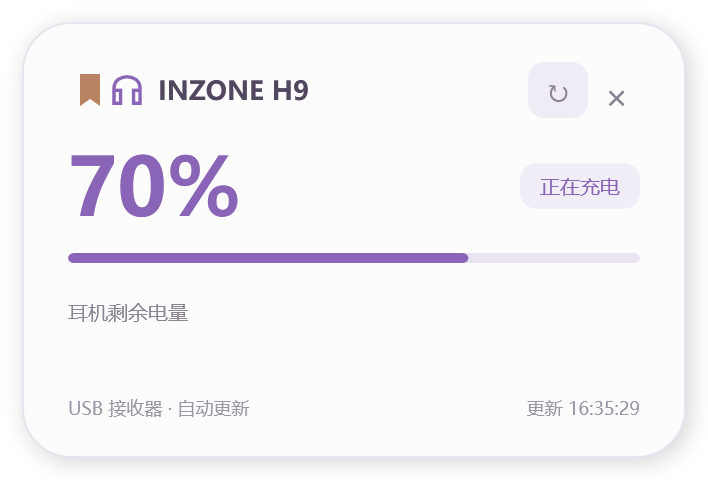

# INZONE H9 Battery Widget

一个轻量的 Windows 耳机电量悬浮组件，通过索尼 INZONE H9 原装 USB 接收器读取真实电量和充电状态。

A small Windows desktop widget that reads battery information from the Sony INZONE H9 USB receiver.



截图中的 70% 是拍摄时接收器返回的读数，不是程序内置的演示数值。

## 下载与运行

**[下载 Windows 便携运行包](downloads/INZONE-H9-Battery-Widget-v1.0.0.zip)**，解压后双击 `H9BatteryShowcase.exe` 即可运行。包内也提供创建启动快捷方式的脚本，不会设置开机自启。

也可以直接下载文件：

1. 打开仓库中的 [`portable`](portable) 文件夹，下载 `H9BatteryShowcase.exe` 和 `H9BatteryShowcase.exe.config` 到同一个本地文件夹，或在仓库首页选择 **Code → Download ZIP** 后解压。
2. 打开 H9 电源，插入原装 USB 接收器，并将接收器设为 PC 模式。
3. 双击 `H9BatteryShowcase.exe`。需要快捷方式时，运行同目录的 `CreateShortcut.ps1`，它只在该目录创建启动快捷方式。

支持 Windows 10/11，需要 .NET Framework 4.8。不需要管理员权限、Python、.NET SDK、INZONE Hub、ChatGPT 或 Codex。程序不会设置开机自启，也不会跟随 ChatGPT 启动。

预编译程序由仓库源码构建，未进行代码签名；也可以自行编译源码使用。

## 操作

- 每 60 秒自动刷新，点击 `↻` 可立即刷新。
- 拖动左上角橙色书签移动组件。
- 右键卡片，可切换普通窗口与桌面显示模式。
- 点击右上角 `×` 退出组件。
- 位置和最近一次状态保存在 `%LOCALAPPDATA%\H9BatteryShowcase`。

不提供模拟、手填或推算电量。读取失败、读数超过 90 秒或协议返回未知值时显示 `—` 和原因。状态文件退出后可能仍保留旧内容，外部程序读取时必须同时检查 `status` 和 `updatedAt`。

## 兼容性与排查

| 设备或情况 | 支持状态 / 处理方式 |
|---|---|
| Sony INZONE H9 原装 USB 接收器 | 已在实机读取电量和充电状态 |
| Sony INZONE H7 | 共用设备标识，预计兼容，尚未实机验证 |
| 其他品牌或型号的 2.4 GHz 耳机 | 不支持通用读取，需要各自协议适配 |
| 仅通过蓝牙连接 | 本项目不读取蓝牙电量 |
| INZONE Hub 或其他电量软件占用串口 | 显示占用提示，请手动退出占用软件后刷新 |
| 耳机关机、超出范围或接收器模式不正确 | 可能无响应，请检查连接；程序无法仅凭超时确定原因 |
| 未知固件、损坏或截断的数据包 | 拒绝显示未经验证的百分比 |

组件匹配 `VID_054C&PID_0E53` 并自动查找端口，不绑定某一副耳机或固定 COM 编号。连接多个匹配接收器时会提示只保留一个。

串口参数：115200、8N1、DTR/RTS 开启、无流控。解析时检查事件标识、来源、长度、校验和及百分比范围。`0xFF` 等未知值不会显示为 0% 或 255%。充电字节为 0/1 时解释为使用电池/充电，其他值显示未知。

## 从源码构建

Windows PowerShell 中运行：

```powershell
powershell.exe -NoProfile -ExecutionPolicy Bypass -File .\build.ps1
```

使用 Windows 自带的 .NET Framework C# 编译器，不下载任何编译依赖。输出为 `portable\H9BatteryShowcase.exe`。`ExecutionPolicy Bypass` 只作用于这次 PowerShell 进程，不修改系统策略。

运行解析器测试：

```powershell
powershell.exe -NoProfile -ExecutionPolicy Bypass -File .\tests\run.ps1
```

15 项测试覆盖正常读数、0%、100%、未知值、校验失败、截断、噪声及多帧等情况。合成数据只用于测试，不会送入运行中的组件。

## 代码来源与致谢

界面与 Windows 桌面机制使用 C#/WPF 编写。串口指令和电量字段参考 [janit88/InZoneH9Tray](https://github.com/janit88/InZoneH9Tray/tree/4780303dbee4bf1a86acf37c2cbc96b1774eee00)，HCI 包结构与校验规则参考 [penguinwokrs/openinzone 的协议文档](https://github.com/penguinwokrs/openinzone/blob/167108990aa674a57a5ba8a6d288d7d4383253b8/docs/PROTOCOL.md)。感谢这些项目的协议研究。

详见 [THIRD_PARTY_NOTICES.md](THIRD_PARTY_NOTICES.md)。本项目是独立、非官方工具，与 Sony 无隶属或背书关系。Sony、INZONE 等名称用于识别兼容硬件。

项目代码按 [MIT License](LICENSE) 分享。

## English quick start

Download both files in `portable`, or use **Code → Download ZIP** and extract it. Run `portable/H9BatteryShowcase.exe` on Windows 10/11 with .NET Framework 4.8. Connect the original H9 USB receiver in PC mode and turn on the headset. Exit INZONE Hub if it owns the serial port.

Drag the orange bookmark to move the card, right-click to switch desktop/normal window modes, click `↻` to refresh or `×` to exit. Refresh is automatic every 60 seconds. Unknown, failed and stale readings appear as `—`. No startup task, ChatGPT integration or simulated battery mode is installed.

H9 hardware has been tested; H7 is expected but unverified. This is not a generic 2.4 GHz headset battery reader. See the linked protocol projects and notices for attribution.
